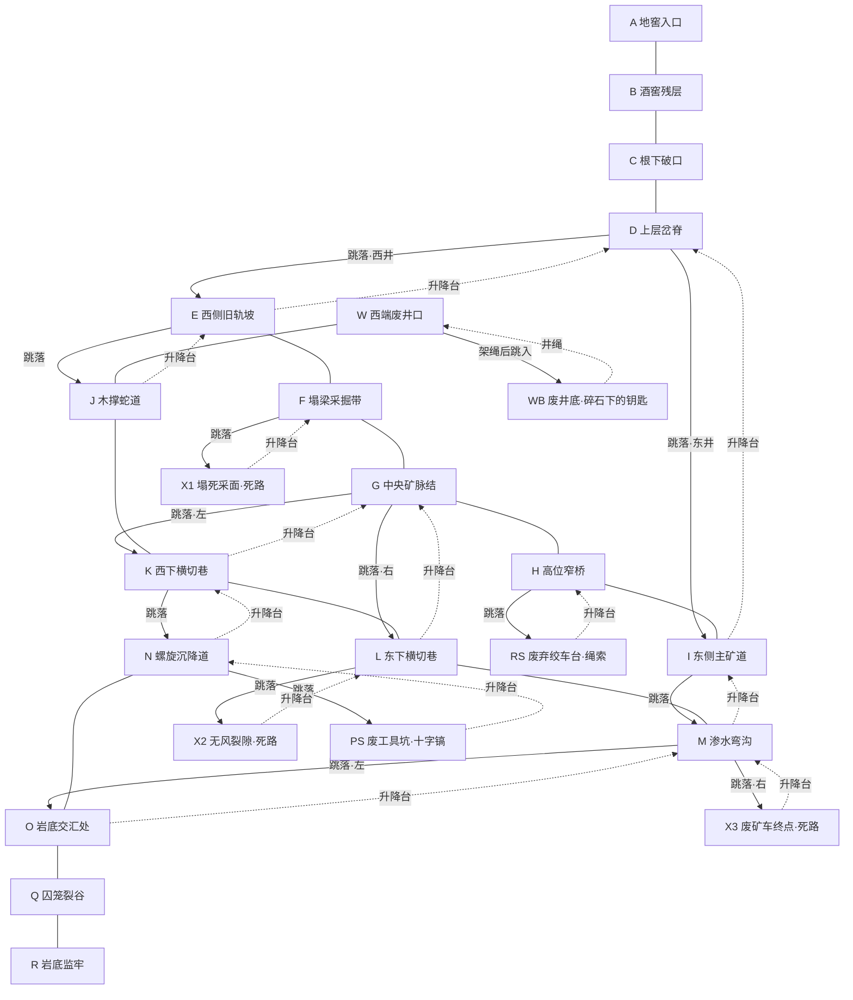

# 1-03《月炉木屋与根下旧矿》· 地窖段设计卡

## 本轮目标

本轮只验收迷宫空间、探索路径和道具因果链，不加入毒气、地刺、摆刃、落石等战斗或计时机关。玩家在黑暗旧矿中依靠有限视野、岔路、回路、死路和地标建立空间记忆，最终找到钥匙并徒步抵达最深处的监牢。

核心闭环：看见西端废井但无法下去 → 去远端绞车台取得绳索 → 返回废井架绳并跳入井底 → 发现钥匙压在碎石下 → 去另一条深层支路取得十字镐 → 返回井底凿开碎石取得钥匙 → 不通过捷径，沿已理解的矿道绕到岩底监牢 → 救出老魔法师。

## 空间规则

- 地窖里不使用区域门、传送门或门框作为路线连接。
- 同层区域由连续的横向矿道自然接通，走到画面边缘即继续进入下一段矿道，不需要按 `F`。
- 下到更深区域只能从断层或竖井主动跳落；切换时保留下坠速度和坠落镜头。
- 回到上层只使用升降台、井绳或矿梯，并在装置附近显示圆形 `F`。按下后角色先站上装置并随平台或井绳上升，抵达竖井顶部才切换到上层，不允许瞬间传送。
- `F` 只用于拾取绳索/十字镐、给废井安装绳索、凿碎石堆、取得钥匙、启动向上装置和营救魔法师。
- 没有自动返回中央区域、钥匙捷径或完成后传送；玩家必须用自己建立的路线记忆往返。

## 竖井成对

同一房间里，落井缺口和向上装置必须分槽，禁止重叠。

- **PIT_A**（相对 X `410–580`）：`down_left` 落井。
- **PIT_B**（相对 X `730–900`）：`down` / `down_right` 落井，以及废井口。
- **LIFT_A**（相对 X `200–360`）：普通房间的回程升降台，落在实地上。
- **LIFT_B**（相对 X `500–660`）：已有 `PIT_B` 时的右侧回程升降台。
- `J / WB / RS / PS` 只有回程井绳或升降台、没有继续向下的缺口，升降台对齐 `PIT_B`，玩家从上层跳入后落在井底实地上。
- 从下层按 `F` 返回时，出生点必须落在对应落井**左侧的实地**，不能出生在缺口里。
- 废井在井沿左侧按 `F` 架绳；架绳后井口才开口，避免角色站在井口正上方时地面突然消失。

## 空间拓扑

实线横连表示同层矿道；向下实线表示玩家跳入的断层/竖井；向上虚线表示升降台、井绳或矿梯。`E-F-G-H-I-D`、`E-J-K-G-F-E`、`G-K-L-G`、`G-H-I-M-L-G`、`K-N-O-M-L-K` 构成多组可互相套叠的回路。

## 探索节奏

1. `A-B-C-D` 是从人工地窖逐步过渡到天然矿穴的定向段，砖石痕迹逐屏消退。
2. `D` 首次让玩家选择东西两口落井；两条路都会进入主回路，但不能立即看见正确目标。
3. `W` 的井架上只有一小截断绳，先用图形说明“缺少长绳”，不显示答案文字。
4. `RS` 的废绞车上挂着可拾取绳索；获得后绳索图标在右上角点亮，玩家需要凭记忆回到 `W`。
5. 在 `W` 安装绳索后井口才成为可下落通道；跳入后落到独立的 `WB` 井底。
6. `WB` 的碎石堆后透出微弱金光。没有十字镐时只显示十字镐剪影，不允许用普通动作绕过。
7. `PS` 位于另一条更深的支路。拾取十字镐后仍可同时保留已经完成的井绳状态，工具之间不互相替换。
8. 返回 `WB` 连续凿击三次，碎石轮廓和数量逐次减少，第三次后钥匙显露；再按一次 `F` 收入物品栏。
9. `R` 位于整个拓扑的最远端。取得钥匙不会开启任何近路，玩家必须沿原路和回路自行找到 `Q-R`。

## 误导与辨识

- `X1 / X2 / X3` 是明确死路：尽头用不同形状的塌方、无风裂缝和废矿车形成辨识，不藏必需道具。
- `G` 是矿脉交汇地标，`H` 是高位木桥地标，`M` 是渗水弯沟地标，`D` 是双井岔脊，`N` 是裂隙沉降道；即使没有小地图，也能靠剪影区分。
- 入口段保留旧酒窖的人工支撑，越深入木撑越歪斜、岩壁越裸露，从材质变化传达深度。
- 横向通道的边缘保持打开的黑色矿洞轮廓，不画门板、门框、锁或交互按钮。

### 房间视觉身份

每个房间由“远处大轮廓 + 中景构筑物 + 地面小物”三层信息组成。通用矿架和轨道只负责说明这里仍属于同一座矿井，不能成为画面主体。

- `A`：顶部木地窖门和斜落光束，是唯一仍能看见地表光的房间。
- `B`：整墙酒架、瓶子和圆桶，保留最强的人工酒窖感。
- `C`：粗大树根贯穿砖墙，人工结构在这里被岩穴吞没。
- `D`：倾斜塌梁横跨两口井，形成清楚的双井剪影。
- `E`：斜向上爬升的旧铁轨和大型刹车轮。
- `F`：六根木梁向中央塌落，碎石堆形成倒三角轮廓。
- `G`：多层同心矿脉拱和顶部格栅，是主回路的视觉锚点。
- `H`：横贯房间上空的窄桥、吊索和细长立柱。
- `I`：最高的石拱、三组垂链和旧方向牌。
- `J`：左右交替弯折的蛇形木撑，轮廓故意不稳定。
- `K`：带网格与白色路线标记的旧测绘板。
- `L`：侧翻矿车、脱落车轮和斜插木梁。
- `M`：冷青滴水、长水迹和地面浅水弧。
- `W`：完整井架和断绳；装绳后出现贯穿井口的长绳。
- `WB`：从顶部垂下的双股井绳、中央碎石与钥匙金光。
- `N`：六道从顶壁向下延伸的裂纹，强调继续下沉。
- `O`：三条岩脉汇聚成中央绳结状轮廓。
- `Q`：三只悬吊空铁笼，提前预告监牢方向。
- `R`：密集牢栏、金色锁孔与老魔法师剪影。
- `RS`：大型三角绞车架和盘绕长绳。
- `PS`：低矮工具架和唯一的十字镐剪影。
- `X1`：木梁交叉压住整面塌石。
- `X2`：一道从顶到底的无风黑裂隙，没有矿车或工具。
- `X3`：撞上止冲架的废矿车，明确表达线路终点。

向上装置也参与辨识：普通回程口使用双导轨矿井升降台；`WB → W` 使用井绳攀升。平台和角色会持续上移约一秒，再进入上层。

## 黑暗与镜头

- 角色周围约 `185 px` 为清晰视野，外侧用约 `105 px` 羽化到近黑；亮区略向角色朝向偏移。
- 从上层跳入下一层时，镜头先跟随角色下坠，再在落地后收稳，不能瞬间把角色放到目标区域地面。
- 首次进入 `R`，光圈短暂移向老魔法师和锁孔，再回到玩家。
- 拾取绳索、十字镐和钥匙时只做短促的物品聚焦与图标点亮，不弹出解法文字。
- 凿碎石堆时每击都有碎屑、裂纹变化和轻微震屏；当前版本没有伤害机关。

## 状态与失败

- 初始检查点位于 `A`。本轮没有中途传送式检查点，以免破坏必须自行往返的迷宫验证。
- 掉出有效地形时回到 `A`，但已经取得的绳索、已安装的井绳、十字镐、碎石破坏进度和钥匙状态保留。
- 重置关卡才清空全部工具与解谜状态。

## 调试入口

地窖不再提供独立 DEBUG 入口。DEBUG 菜单中的 `1-03 · 月炉木屋与根下旧矿` 从木屋开始，完成三相结界并跳入地窖后继续本段；`Debug Start Level = 3` 使用同一完整入口。营救老魔法师后停留在 `LEVEL_03_RESCUED`，作为当前版本终点，不再自动进入后续关卡。地窖内按 `R` 会重新开始整个 `1-03`，Esc 可随时返回 DEBUG 菜单。
